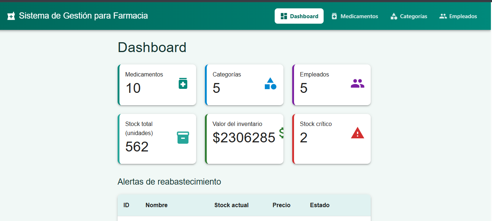
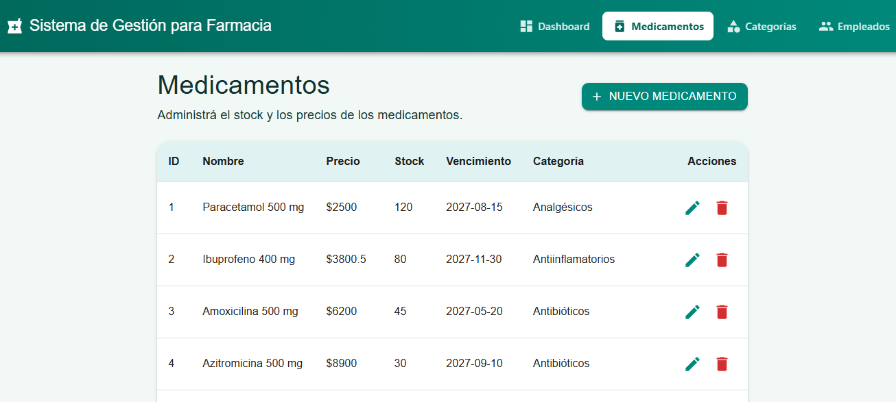
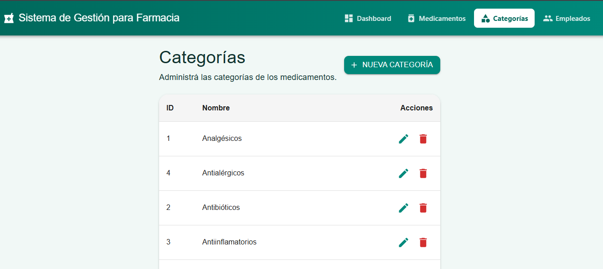
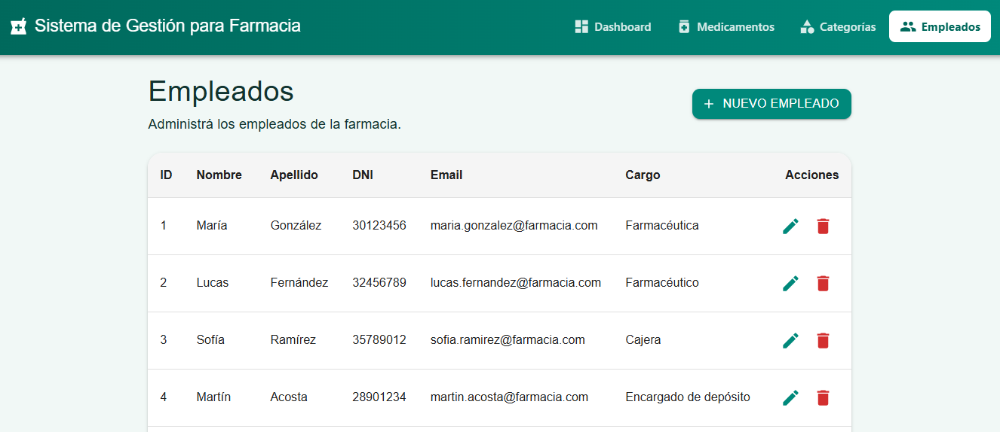

# 💊 Sistema de Gestión para Farmacia

Trabajo Práctico de **Programación II** – IES 9-023.

## 👥 Integrantes

- Antonio Javier Cabrera ([@javicabrera10](https://github.com/javicabrera10))
- Marcelo Britos ([@MARCE-clod](https://github.com/MARCE-clod))

## 📖 Descripción

Mini aplicación web para la gestión de una farmacia. Permite administrar **medicamentos**, **categorías** y **empleados** mediante operaciones CRUD (crear, listar, consultar, modificar y eliminar), y cuenta con un **Dashboard** que muestra datos del negocio en tiempo real.

Arquitectura:

```
ReactJS (Material UI)
   │  HTTP / JSON
   ▼
Flask API REST (MVC)
   │  SQLAlchemy
   ▼
MySQL
```

Funcionalidades principales:

- CRUD completo de medicamentos, categorías y empleados.
- Dashboard con cantidad de medicamentos, categorías y empleados, stock total, valor del inventario y alertas de stock crítico (5 unidades o menos).
- Validaciones en el backend y en el frontend (precio mayor a 0, stock no negativo, categorías no duplicadas, email válido, etc.).
- Mensajes de éxito y error con Snackbar, Alert y Dialog de Material UI.

## 🛠️ Tecnologías utilizadas

**Backend:** Python, Flask, Flask-SQLAlchemy, PyMySQL, Flask-CORS, python-dotenv, API REST, arquitectura MVC.

**Frontend:** ReactJS, JavaScript, Material UI (MUI), React Router, Fetch API, Vite.

**Base de datos:** MySQL.

**Control de versiones:** Git y GitHub.

## ✅ Requisitos

- [Python](https://www.python.org/) 3.12 o superior
- [uv](https://docs.astral.sh/uv/) (gestor de paquetes de Python)
- [Node.js](https://nodejs.org/) 20.19 o superior (recomendado 22) y npm
- [MySQL](https://dev.mysql.com/downloads/) 8 (o MariaDB compatible)
- [Git](https://git-scm.com/)

## 📦 Instalación de dependencias

Clonar el repositorio:

```bash
git clone https://github.com/javicabrera10/sistema-gestion-farmacia.git
cd sistema-gestion-farmacia
```

**Backend** (desde la raíz del proyecto):

```bash
uv sync
```

**Frontend:**

```bash
cd frontend
npm install
```

## 🗄️ Configuración de MySQL

1. Asegurate de tener el servidor de MySQL iniciado.
2. Ejecutá el script que crea la base de datos `farmacia_db`, sus tablas y los datos iniciales (10 medicamentos, 5 categorías y 5 empleados). Desde la raíz del proyecto:

   ```bash
   mysql -u root -p < database/farmacia_db.sql
   ```

   También podés abrir `database/farmacia_db.sql` en MySQL Workbench y ejecutarlo completo.

> ⚠️ El script comienza con `DROP DATABASE IF EXISTS farmacia_db`, por lo que **borra y recrea** la base cada vez que se ejecuta. Si ya tenías datos propios en esa base, se pierden.

### Modelo de datos

| Tabla | Campos | Notas |
|---|---|---|
| `categorias` | `id` (PK), `nombre` | `nombre` es único |
| `medicamentos` | `id` (PK), `nombre`, `precio`, `stock`, `fecha_vencimiento`, `categoria_id` (FK) | `categoria_id` → `categorias.id` |
| `empleados` | `id` (PK), `nombre`, `apellido`, `dni`, `email`, `cargo` | `dni` y `email` son únicos |

Relación: una **categoría** tiene muchos **medicamentos** (1 a N).

## ⚙️ Configuración del backend

En la raíz del proyecto, copiá el archivo de ejemplo y completá tus datos de MySQL:

```bash
# Linux / Mac / Git Bash
cp .env.example .env

# Windows (PowerShell / CMD)
copy .env.example .env
```

Contenido del `.env`:

```env
DB_USER=root
DB_PASSWORD=tu_contraseña
DB_HOST=localhost
DB_PORT=3306
DB_NAME=farmacia_db
```

> El archivo `.env` contiene credenciales y está en el `.gitignore`: **no se sube al repositorio**.

## 🎨 Configuración del frontend

El frontend consume la API en `http://127.0.0.1:5000/api`. Esa URL está definida en `frontend/src/services/api.js` (constante `API_URL`). Si cambiás el puerto del backend, modificala ahí.

## ▶️ Cómo ejecutar el proyecto

Se necesitan **dos terminales** abiertas al mismo tiempo.

**Terminal 1 – Backend (puerto 5000):**

```bash
cd backend
uv run python app.py
```

**Terminal 2 – Frontend (puerto 5173):**

```bash
cd frontend
npm run dev
```

Abrí el navegador en **http://localhost:5173**.

### Rutas de la API

| Recurso | Método | Ruta |
|---|---|---|
| Medicamentos | GET | `/api/medicamentos` |
| | GET | `/api/medicamentos/<id>` |
| | POST | `/api/medicamentos` |
| | PUT | `/api/medicamentos/<id>` |
| | DELETE | `/api/medicamentos/<id>` |
| Categorías | GET | `/api/categorias` |
| | GET | `/api/categorias/<id>` |
| | POST | `/api/categorias` |
| | PUT | `/api/categorias/<id>` |
| | DELETE | `/api/categorias/<id>` |
| Empleados | GET | `/api/empleados` |
| | GET | `/api/empleados/<id>` |
| | POST | `/api/empleados` |
| | PUT | `/api/empleados/<id>` |
| | DELETE | `/api/empleados/<id>` |
| Dashboard | GET | `/api/dashboard` |

## 📁 Estructura del proyecto

```
sistema-gestion-farmacia/
├── README.md
├── .env.example
├── .gitignore
├── pyproject.toml
├── uv.lock
│
├── backend/
│   ├── app.py              # Punto de entrada de Flask
│   ├── config.py           # Configuración (lee el .env)
│   ├── database.py         # Instancia de SQLAlchemy
│   ├── models/             # Modelos (M): Categoria, Medicamento, Empleado
│   ├── controllers/        # Lógica y validaciones (C)
│   └── routes/             # Rutas / blueprints de la API
│
├── database/
│   └── farmacia_db.sql     # Estructura + datos iniciales
│
├── docs/
│   └── capturas/           # Capturas de pantalla del README
│
└── frontend/
    └── src/
        ├── components/     # Navbar
        ├── layouts/        # MainLayout
        ├── pages/          # Dashboard, Medicamentos, Categorias, Empleados
        ├── services/       # api.js (consumo de la API)
        ├── App.jsx         # Rutas y tema de Material UI
        └── App.css         # Estilos del navbar y paleta de colores
```

En el patrón **MVC** del backend: los **modelos** definen las tablas, los **controladores** contienen la lógica y las validaciones, y las **rutas** conectan cada URL con su controlador. La **vista** es el frontend en React, que consume la API en formato JSON.

## 📸 Capturas de pantalla

### Dashboard


### Medicamentos


### Categorías


### Empleados


## 🤝 Integrantes y distribución general de tareas

| Integrante | Tareas realizadas |
|---|---|
| **Antonio Javier Cabrera** | • Configuración del proyecto y de las dependencias del backend con `uv`.<br>• Modelos y configuración de la base de datos.<br>• Controladores y rutas de categorías y empleados (API REST).<br>• Base inicial del frontend con React y Vite.<br>• CRUD de categorías en el frontend y corrección del orden de hooks en Categorías y Empleados.<br>• Navbar superior y paleta de colores de farmacia con tema de Material UI.<br>• Unificación del prefijo `/api` en las rutas.<br>• Script de base de datos `farmacia_db.sql` con los datos iniciales.<br>• Dashboard completo (cantidad de medicamentos, categorías y empleados).<br>• Validaciones del backend y manejo de errores en medicamentos (Snackbar, Alert y Dialog).<br>• README. |
| **Marcelo Britos** | • Modelo, controlador y rutas de medicamentos (blueprint integrado a la app).<br>• Módulo de medicamentos y dashboard funcional conectando Flask y React.<br>• Interfaz de categorías conectada con el backend.<br>• Integración de la rama `feature/marcelo` en el repositorio. |

Ambos integrantes conocen y pueden explicar el funcionamiento general del sistema (base de datos, backend, frontend y Git).

### Trabajo con Git y GitHub

- **Ramas:** `main` (versión estable para la entrega), `develop` (integración) y ramas de trabajo por integrante: `feature/javier` y `feature/marcelo`.
- **Flujo:** cada integrante trabaja en su rama, hace varios commits y los sube con `git push`. Después se abre un **Pull Request** hacia `develop`, y `develop` pasa a `main` al cerrar cada etapa.
- **Integración:** los cambios se integran mediante Pull Request y merge. Cuando `develop` avanzó con cambios del otro integrante, se hizo un merge de `develop` en la rama de trabajo para resolver los conflictos antes de abrir el Pull Request.
- **Commits:** mensajes descriptivos, por ejemplo "Agregar validaciones del backend y mejorar manejo de errores en medicamentos" o "feat: implementar controller de medicamentos".
